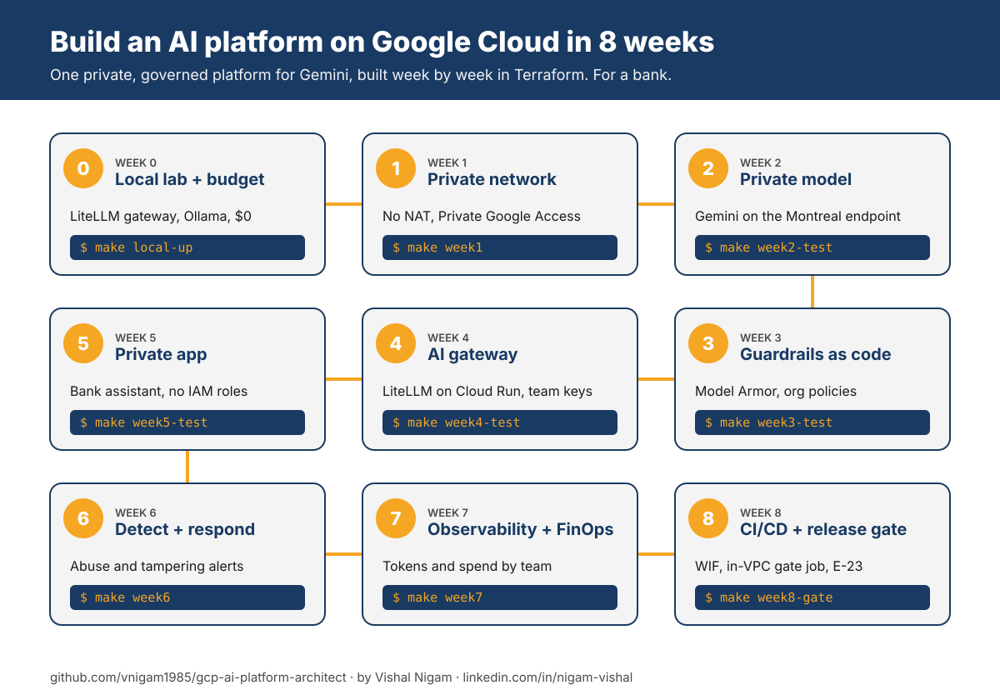

# Google Cloud AI Platform Architect Roadmap 2026

> A step-by-step guide and an 8-week build-along course for becoming a **Cloud AI Platform Architect on Google Cloud**: private networking, guardrails, an AI gateway, security, FinOps and CI/CD for Gemini, with working Terraform.

<p align="left">
  <a href="https://www.linkedin.com/in/nigam-vishal/"></a>
  <a href="https://www.youtube.com/@thrivewithvishal"></a>
  <a href="https://www.instagram.com/thrivewithvishal"></a>
  <a href="https://vnigam1985.github.io"></a>
  <a href="https://mentoraccelerate.com/90-day-job-search-framework"></a>
</p>

Most AI roadmaps teach you to build a chatbot. This one teaches you to build the **platform** every chatbot, agent and RAG app in a large company runs on: private networking, IAM, guardrails, an AI gateway, observability and cost control. That's the part enterprises struggle with, and the part they pay architects for.

It's written for cloud, platform, network, security and DevOps engineers who already know Google Cloud infrastructure and want to move into AI. If you know VPCs, Private Google Access, IAM and org policies, you already have half of this job.

There are two ways to use it:

1. **The 8-week build-along course.** Build one private, governed AI platform on Google Cloud in Terraform, a layer a week, and run a real workload on it.
2. **The roadmap.** Twelve steps of what to learn, with free and paid resources, certifications and interview prep.

## ⭐ Give a Star

If this helps you learn or plan your career, please give it a star. It helps other engineers find it.

## ⚠️ Disclaimer

Google Cloud AI moves fast. In April 2026 Vertex AI was renamed **Gemini Enterprise Agent Platform** (the API host is still `aiplatform.googleapis.com`), Gemini 2.5 models were retired in October 2026, and a new Professional Agentic Architect certification is arriving. Facts and links here were checked in **October 2026** (see [VERIFICATION.md](VERIFICATION.md)). If something looks out of date, open an issue.

This roadmap shows the landscape. You don't need every tool on it. Learn the fundamentals deeply, then pick what your organization actually uses.

---

## Table of Contents

- [🚀 The 8-week build-along course](#-the-8-week-build-along-course)
- [The role in one picture](#the-role-in-one-picture)
- [Learning path (mostly free)](#learning-path-mostly-free)
  1. [GenAI fundamentals for infrastructure people](#1-genai-fundamentals-for-infrastructure-people)
  2. [Gemini Enterprise Agent Platform (formerly Vertex AI)](#2-gemini-enterprise-agent-platform-formerly-vertex-ai)
  3. [The app plane](#3-the-app-plane)
  4. [Private networking for AI](#4-private-networking-for-ai)
  5. [The AI gateway](#5-the-ai-gateway)
  6. [Governance: org policies and VPC Service Controls](#6-governance-org-policies-and-vpc-service-controls)
  7. [Security for AI and agents](#7-security-for-ai-and-agents)
  8. [RAG and agent building blocks](#8-rag-and-agent-building-blocks)
  9. [Infrastructure as Code and landing zones](#9-infrastructure-as-code-and-landing-zones)
  10. [Observability and FinOps](#10-observability-and-finops)
  11. [Regulated industries (banking and OSFI)](#11-regulated-industries)
  12. [AI-assisted platform engineering](#12-ai-assisted-platform-engineering)
- [Certifications](#certifications)
- [Interview preparation](#interview-preparation)
- [Repository map](#repository-map)
- [About the author](#-about-the-author)

---

## 🚀 The 8-week build-along course



| Week | Topic | You build | Command | Branch |
| --- | --- | --- | --- | --- |
| 0 | [Setup and local lab](weeks/00-setup-and-local-lab/README.md) | The whole request path on your laptop for $0 (LiteLLM gateway + Ollama), then a budget | `make local-up` | `week-00` |
| 1 | [Private network](weeks/01-private-network/README.md) | Custom VPC, no NAT, Private Google Access, IAP-only SSH, flow logs | `make week1` | `week-01` |
| 2 | [Private model](weeks/02-private-model/README.md) | Gemini on the Montreal endpoint from a VM with no internet, keyless, audit-logged | `make week2-test` | `week-02` |
| 3 | [Guardrails as code](weeks/03-guardrails-as-code/README.md) | Model Armor template, and org policies if you have an Organization | `make week3-test` | `week-03` |
| 4 | [AI gateway](weeks/04-ai-gateway/README.md) | LiteLLM on internal Cloud Run, team keys with token limits, Model Armor on every call, private Cloud SQL | `make week4-test` | `week-04` |
| 5 | [Private app](weeks/05-private-app/README.md) | The bank assistant on internal Cloud Run with a role-less service account | `make week5-test` | `week-05` |
| 6 | [Detect and respond](weeks/06-detect-and-respond/README.md) | Gateway abuse alerts, Model Armor block alerts, control-tampering alerts | `make week6` | `week-06` |
| 7 | [Observability and FinOps](weeks/07-observability-finops/README.md) | Token dashboard, daily token alert, spend per team key | `make week7` | `week-07` |
| 8 | [CI/CD and release gate](weeks/08-cicd-release-gate/README.md) | Workload Identity Federation, in-VPC gate job with rollback, OSFI E-23 model inventory | `make week8-gate` | `week-08` |

**Quickstart:** `make local-up && make local-keys && make local-test` (free), then `make week0 BILLING=<billing account>`.

**Cost:** week 0 is $0. The Google Cloud weeks cost roughly **$10 to $25** if you finish within two to three weeks and pause between sessions. Details: [COSTS.md](COSTS.md). Use a new project on your own billing account, never your employer's.

**Want to test the AI instead of hosting it?** The companion course [ai-quality-engineer](https://github.com/vnigam1985/ai-quality-engineer) uses the same bank assistant.

---

## The role in one picture

An AI Platform Architect owns four planes. Most engineers come in strong on one or two.

| Plane | What it covers on Google Cloud | Typical starting point |
| --- | --- | --- |
| **Network plane** | Shared VPC, Private Google Access, Private Service Connect, Cloud DNS, egress control | Network and platform engineers |
| **Governance plane** | Resource hierarchy, org policies, VPC Service Controls, IAM, approved models, data residency | Cloud governance and security engineers |
| **AI service plane** | Gemini Enterprise Agent Platform models and endpoints, Model Armor, Agent Runtime, Agent Search | Data and AI engineers |
| **App and gateway plane** | Cloud Run, GKE, Apigee, load balancers, the AI gateway | App and DevOps engineers |

---

## Learning path (mostly free)

Resource tags: **FREE**, **PAID**, **Udemy**, **Docs**, **Repo**, **Blog**.

### 1. GenAI fundamentals for infrastructure people

You don't need to train models. You do need to speak the language well enough to design for it.

Here you need to learn:
- What a token is, and why every quota, limit and bill is measured in tokens
- How RAG works: chunking, embeddings, vector search, grounding
- What an agent does differently from a chatbot (it calls tools and takes actions)
- What MCP (Model Context Protocol) is, and why companies now need to govern MCP servers

Resources:
- [Generative AI Leader learning path](https://www.skills.google/paths/1951) on Google Skills (**FREE**)
- [Google Cloud certification overview](https://cloud.google.com/learn/certification) (**FREE**, Docs)

### 2. Gemini Enterprise Agent Platform (formerly Vertex AI)

Here you need to learn:
- **Endpoints and locations.** Regional endpoints (`<region>-aiplatform.googleapis.com`) vs `global`. For a Canadian bank, where a prompt is processed is a compliance decision
- **Model lifecycle.** Models retire on published dates (Gemini 2.5 retired on October 20, 2026). Your platform needs a plan for upgrades
- **Provisioned Throughput** (GSUs) vs pay-as-you-go
- The **OpenAI-compatible endpoint**, so OpenAI-SDK apps can call Gemini
- The new names: Agent Runtime (was Agent Engine), Agent Search (was Vertex AI Search)

Resources:
- [Introducing Gemini Enterprise Agent Platform](https://cloud.google.com/blog/products/ai-machine-learning/introducing-gemini-enterprise-agent-platform) (**FREE**, Blog)
- [Locations](https://docs.cloud.google.com/gemini-enterprise-agent-platform/resources/locations) (**FREE**, Docs). Bookmark it
- [Agent locations](https://docs.cloud.google.com/gemini-enterprise-agent-platform/resources/agent-locations) (**FREE**, Docs)
- [Using OpenAI libraries with the platform](https://docs.cloud.google.com/gemini-enterprise-agent-platform/models/start/openai) (**FREE**, Docs)
- Course: [week 2](weeks/02-private-model/README.md)

### 3. The app plane

Here you need to learn:
- Cloud Run ingress settings, Direct VPC egress, service identities
- GKE for heavier AI workloads
- Load balancers and Cloud Armor in front of AI apps
- Secret Manager and Workload Identity

Resources:
- [Cloud Run ingress](https://docs.cloud.google.com/run/docs/securing/ingress) and [private networking](https://docs.cloud.google.com/run/docs/securing/private-networking) (**FREE**, Docs)
- Course: [week 5](weeks/05-private-app/README.md)

### 4. Private networking for AI

This is where network engineers win.

Here you need to learn:
- **Private Google Access** for VMs and serverless with no external IP, and what it doesn't cover (regional `rep.googleapis.com` endpoints)
- **Private Service Connect** endpoints for Google APIs (`all-apis`, `vpc-sc`) and for regional endpoints
- **`private.googleapis.com` and `restricted.googleapis.com`** DNS patterns
- **Shared VPC** and hub-and-spoke designs for many AI teams

Resources:
- [Private Google Access](https://docs.cloud.google.com/vpc/docs/private-google-access) (**FREE**, Docs)
- [Access Google APIs through Private Service Connect endpoints](https://docs.cloud.google.com/vpc/docs/configure-private-service-connect-apis) (**FREE**, Docs)
- Course: [weeks 1 and 2](weeks/01-private-network/README.md)

### 5. The AI gateway

Every serious enterprise puts a gateway between apps and models: per-team token budgets, chargeback, model routing, central safety screening.

Here you need to learn:
- **Apigee AI policies**: `PromptTokenLimit`, `LLMTokenQuota`, `SemanticCacheLookup` / `Populate`, `SanitizeUserPrompt` / `SanitizeModelResponse` (Model Armor). They're extensible policies, so they need an Intermediate or Comprehensive environment
- Open-source gateways such as LiteLLM on Cloud Run, and when each makes sense
- Token analytics for chargeback

Resources:
- [Apigee AI token policies tutorial](https://docs.cloud.google.com/apigee/docs/api-platform/tutorials/using-ai-token-policies) (**FREE**, Docs)
- [PromptTokenLimit policy](https://docs.cloud.google.com/apigee/docs/api-platform/reference/policies/prompt-token-limit-policy) (**FREE**, Docs)
- [GoogleCloudPlatform/apigee-samples](https://github.com/GoogleCloudPlatform/apigee-samples) (**FREE**, Repo)
- Course: [week 4](weeks/04-ai-gateway/README.md)

### 6. Governance: org policies and VPC Service Controls

Here you need to learn:
- **`vertexai.allowedModels`**: the approved-model list, value format `publishers/<publisher>/models/<model>:<action>`
- **`gcp.resourceLocations`** for data residency
- **VPC Service Controls** perimeters around AI projects, dry-run first
- **Data Access audit logs** for the model API (off by default)
- All of these need an **Organization**

Resources:
- [Control access to models](https://docs.cloud.google.com/gemini-enterprise-agent-platform/models/control-model-access) (**FREE**, Docs)
- [Organization policy constraints](https://docs.cloud.google.com/organization-policy/reference/org-policy-constraints) (**FREE**, Docs)
- [VPC Service Controls overview](https://docs.cloud.google.com/vpc-service-controls/docs/overview) (**FREE**, Docs)
- Course: [week 3](weeks/03-guardrails-as-code/README.md)

### 7. Security for AI and agents

Here you need to learn:
- **Model Armor**: prompt injection and jailbreak detection, Responsible AI filters, Sensitive Data Protection, malicious URLs; templates and floor settings
- **Security Command Center AI Protection** (Premium): AI inventory, posture and threats. The Enterprise tier shuts down on May 21, 2027
- Threat models: OWASP Top 10 for LLM Applications and for Agentic Applications

Resources:
- [Model Armor overview](https://docs.cloud.google.com/model-armor/overview) (**FREE**, Docs)
- [AI Protection overview](https://docs.cloud.google.com/security-command-center/docs/ai-protection-overview) (**FREE**, Docs)
- [OWASP GenAI LLM Top 10 2026](https://genai.owasp.org/home/resources/owasp-genai-llm-top-10-2026/) and [OWASP Top 10 for Agentic Applications](https://genai.owasp.org/resource/owasp-top-10-for-agentic-applications/) (**FREE**)
- Course: [weeks 3 and 6](weeks/06-detect-and-respond/README.md)

### 8. RAG and agent building blocks

Here you need to learn:
- **Agent Runtime** (formerly Agent Engine), Sessions and Memory Bank, and where each can store data
- **Agent Search** (formerly Vertex AI Search) and vector search options
- **Agent Development Kit (ADK)** and MCP on Google Cloud

Resources:
- [GoogleCloudPlatform/generative-ai](https://github.com/GoogleCloudPlatform/generative-ai) (**FREE**, Repo)
- [Agent locations](https://docs.cloud.google.com/gemini-enterprise-agent-platform/resources/agent-locations) (**FREE**, Docs)

### 9. Infrastructure as Code and landing zones

Here you need to learn:
- Resource hierarchy, folders and projects for AI workloads
- The Google Terraform provider, including Model Armor and Cloud Run v2 resources
- Remote state in Cloud Storage, plan reviews, and GitHub Actions with Workload Identity Federation

Resources:
- [terraform-google-modules/terraform-example-foundation](https://github.com/terraform-google-modules/terraform-example-foundation) (**FREE**, Repo)
- [GoogleCloudPlatform/cloud-foundation-fabric](https://github.com/GoogleCloudPlatform/cloud-foundation-fabric) (**FREE**, Repo)
- Course: every week is Terraform; [week 8](weeks/08-cicd-release-gate/README.md) adds the pipeline

### 10. Observability and FinOps

Here you need to learn:
- Model metrics: `publisher/online_serving/token_count`, `model_invocation_count`, latencies (some are BETA)
- Billing export to BigQuery, and cost by SKU, project and label
- Per-team spend from the gateway, and reconciliation with billing

Resources:
- [Google Cloud metrics: aiplatform](https://docs.cloud.google.com/monitoring/api/metrics_gcp_a_b) (**FREE**, Docs)
- [Export Cloud Billing data to BigQuery](https://docs.cloud.google.com/billing/docs/how-to/export-data-bigquery) (**FREE**, Docs)
- Course: [week 7](weeks/07-observability-finops/README.md)

### 11. Regulated industries

Banks, insurers and governments are the biggest buyers of AI platform architects, and the most demanding. In Canada, the key regulator for banks is OSFI.

Here you need to learn:
- **OSFI Guideline E-23 (Model Risk Management)**, in force **May 1, 2027**. AI and ML models are in scope: inventory, risk rating, validation, monitoring, including third-party foundation models
- **OSFI Guideline B-13** (Technology and Cyber Risk Management)
- Where prompts are processed (regional vs global endpoints) and how you prove it

Resources:
- [OSFI Guideline E-23: Model Risk Management (2027)](https://www.osfi-bsif.gc.ca/en/guidance/guidance-library/guideline-e-23-model-risk-management-2027) (**FREE**)
- [OSFI Guideline B-13: Technology and Cyber Risk Management](https://www.osfi-bsif.gc.ca/en/guidance/guidance-library/technology-cyber-risk-management) (**FREE**)
- Course: the [model inventory](governance/model-inventory/model_inventory.yaml) in [week 8](weeks/08-cicd-release-gate/README.md)

### 12. AI-assisted platform engineering

The best defence against being replaced by AI is being the engineer who gets 3x more done with it. Use coding agents to draft Terraform, IAM and runbooks, and stay the reviewer.

Here you need to learn:
- Drafting IaC with an AI coding assistant, then validating with `terraform validate` and `plan`
- Giving the agent your standards: naming, labels, approved modules
- Reviewing AI output like a pull request: never trust it, always test it

Resources:
- [google-gemini/gemini-cli](https://github.com/google-gemini/gemini-cli) (**FREE**, Repo)

---

## Certifications

| Certification | Why it matters | Priority |
| --- | --- | --- |
| [Generative AI Leader](https://cloud.google.com/learn/certification/generative-ai-leader) | Vocabulary and business framing | Optional |
| [Professional Cloud Architect](https://cloud.google.com/learn/certification/cloud-architect) | The architect credential hiring managers look for | **High** |
| Professional Agentic Architect | New, for designing agent platforms (beta September 2026, general availability expected mid-November 2026) | **High** once available |
| [Professional Cloud Security Engineer](https://cloud.google.com/learn/certification/cloud-security-engineer) | VPC Service Controls, IAM, security for AI | High |
| [Professional Cloud Network Engineer](https://cloud.google.com/learn/certification/cloud-network-engineer) | The networking half of the job | Medium |

Check the [certification page](https://cloud.google.com/learn/certification) for current exams; Google is updating several for the new product names.

Paid prep:
- [Be a Generative AI Leader: Google Cloud Certification](https://www.udemy.com/course/google-cloud-certified-generative-ai-leader-certification/) by in28Minutes. 4.6 from about 7,800 ratings, about 4 hours (**Udemy**, October 2026)

---

## Interview preparation

Practise answering these out loud, with diagrams:

1. Design a private GenAI platform on Google Cloud for 40 internal teams at a Canadian bank. How do you enforce data residency, per-team token budgets and chargeback?
2. Regional endpoint vs global endpoint: what changes, and how do you make sure no team uses `global`?
3. Walk through VPC Service Controls for an AI project: perimeter, restricted services, ingress for CI/CD, dry-run.
4. Apigee AI policies or an open-source gateway on Cloud Run: when do you pick each?
5. Where does Model Armor sit in the request path, and what does it catch that IAM can't?
6. A model your apps use retires next quarter. What's your process?
7. Leadership asks "what are we spending on AI, by team?" What do you build?
8. What does OSFI E-23 require for a third-party foundation model, and what evidence does your platform produce?

The course weeks each end with a resume bullet. Use them.

---

## Repository map

```
gcp-ai-platform-architect/
├── README.md                 ← you are here
├── weeks/                    the 8-week course, one folder per week
├── infra/                    Terraform, one root per week (local state), plus the gate image
├── app/                      the bank assistant workload (same app as ai-quality-engineer)
├── local/                    week 0 local lab: LiteLLM gateway config and tests
├── governance/               model inventory (E-23)
├── scripts/ + evals/         tests, release gate, inventory checks
├── Makefile                  every command: make help
├── COSTS.md                  what it costs and how to keep it low
└── VERIFICATION.md           what was tested and what wasn't
```

Every Terraform root is checked with `terraform fmt` and `terraform validate` on every push by [.github/workflows/validate.yml](.github/workflows/validate.yml).

## Contribution

Found an outdated link, a better resource, or a bug in the course? Open an issue or a pull request. See [CONTRIBUTING.md](CONTRIBUTING.md).

## License

[MIT](LICENSE)

---

## 👋 About the author

**Vishal Nigam** is a Senior Cloud Engineer and Azure SME with 18+ years in enterprise IT. He builds cloud platforms, landing zones, network security and guardrails for large regulated companies, and now helps engineers move into AI platform work.

He came to Canada in 2017 with $5,000, a wife, a 4-year-old son and zero connections. He has since landed 6 job offers in Canada without a single direct application. No one handed him a playbook, so he built one, and he shares it for free.

He teaches systems, strategy and execution. Not motivation.

### Follow for more

| Where | What you get |
| --- | --- |
| [LinkedIn](https://www.linkedin.com/in/nigam-vishal/) | Azure platform engineering, cloud careers and job search, posted several times a week |
| [YouTube](https://www.youtube.com/@thrivewithvishal) | Long-form videos on cloud careers and platform engineering |
| [Instagram @thrivewithvishal](https://www.instagram.com/thrivewithvishal) | Cloud career tips and the personal journey |
| [Instagram @mentoraccelerate](https://www.instagram.com/mentoraccelerate) | Cloud, DevOps, job search and interview tips |
| [Instagram @cloudwithvishal](https://www.instagram.com/cloudwithvishal) | Cloud Episodes in Hindi, cloud interview reels |
| [Instagram @cloudwithvishal.en](https://www.instagram.com/cloudwithvishal.en) | Cloud Episodes in English |
| [X](https://x.com/thrivewidvishal) | Quick takes on cloud and AI |
| [Facebook](https://www.facebook.com/people/Vishal-Nigam/61565195962651/) | Updates and videos |
| [Portfolio](https://vnigam1985.github.io) | Projects and experience |
| [GitHub](https://github.com/vnigam1985) | More free roadmaps and templates |
| [All links](https://linktr.ee/nigamv) | Everything in one place |

### Free resources

- 📘 **[90-Day Job Search Framework](https://mentoraccelerate.com/90-day-job-search-framework)**: the step-by-step system for landing a cloud role, free
- 🤝 **[MentorAccelerate Cloud Career Community waitlist](https://mentoraccelerate.com/cloudcareercommunitywaitlist)**: a place to prepare for cloud roles and get help from working cloud engineers

### More free roadmaps by Vishal

| Repo | For |
| --- | --- |
| [azure-ai-platform-architect](https://github.com/vnigam1985/azure-ai-platform-architect) | Becoming an AI Platform Architect on Microsoft Azure |
| [aws-ai-platform-architect](https://github.com/vnigam1985/aws-ai-platform-architect) | Becoming an AI Platform Architect on AWS |
| [gcp-ai-platform-architect](https://github.com/vnigam1985/gcp-ai-platform-architect) | Becoming an AI Platform Architect on Google Cloud |
| [ai-quality-engineer](https://github.com/vnigam1985/ai-quality-engineer) | QA and test engineers moving into AI and LLM testing |

If this repo helped you, **star it**, and tell Vishal on LinkedIn what you built with it.
