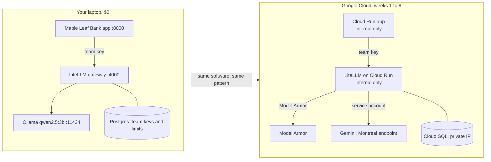

# Week 0: Set up, and build the whole platform on your laptop first ($0)

**Goal:** see the shape of an enterprise AI platform before you spend a cent on Google Cloud. You run the same three layers locally: the app, an AI gateway, and a model.



On Google Cloud you'll run **the same gateway software** (LiteLLM) that you run here. Google's managed option is Apigee with its AI policies, but those need an Intermediate environment (about USD 1,460 a month in October 2026). Week 4 compares the two so you can explain the choice.

## Part A: tools (30 minutes)

| Tool | Why | Install |
| --- | --- | --- |
| Docker Desktop | Local lab only (Google Cloud builds your images for you later) | [docker.com](https://www.docker.com/products/docker-desktop/) |
| Google Cloud CLI | Every Google Cloud step | [Install the gcloud CLI](https://docs.cloud.google.com/sdk/docs/install-sdk) |
| Terraform 1.9+ | All the infrastructure | [Install Terraform](https://developer.hashicorp.com/terraform/install) |
| make, git, Python 3.11+, openssl | Commands and scripts | Your OS package manager |
| A **new** Google Cloud project with billing | Weeks 1 to 8 | Your own billing account. **Not your employer's.** |

```bash
gcloud auth login
gcloud auth application-default login    # Terraform uses these credentials
gcloud projects create <your-lab-project-id>
gcloud billing projects link <your-lab-project-id> --billing-account=<BILLING_ACCOUNT_ID>
gcloud config set project <your-lab-project-id>
```

A dedicated project means `gcloud projects delete` cleans up everything at the end.

## Part B: the local lab (1 hour)

```bash
git clone https://github.com/vnigam1985/gcp-ai-platform-architect.git
cd gcp-ai-platform-architect
make local-up      # app, gateway, Postgres, Ollama; pulls a 2 GB model the first time
make local-keys    # the app's team key: 20 requests/min, 20,000 tokens/min
make local-test    # 6 checks
```

Expected:

```
PASS  no key is refused (401)
PASS  wrong key is refused (401)
PASS  team key works (200)
PASS  team key can't use other models (403)
PASS  3rd call in a minute is throttled (429)
PASS  app answers through the gateway
6 passed, 0 failed
```

Open http://localhost:8000 and ask "How much is an international wire transfer?"

In [local/litellm-config.yaml](../../local/litellm-config.yaml), apps ask for `bank-chat` and the gateway decides what serves it. On Google Cloud, `bank-chat` points at Gemini, and the app doesn't change. Stop Ollama (`docker compose stop ollama`) and ask again to watch the fallback to the `mock` model.

## Part C: a budget before anything else (15 minutes)

```bash
gcloud billing accounts list
make check
make week0 BILLING=XXXXXX-XXXXXX-XXXXXX
```

You need the **Billing Account Costs Manager** role (or Billing Account Administrator) on the billing account. Alerts go to billing admins at 50% and 90% of actual spend and 100% of forecast. The amount is in your billing account's currency. A budget never stops spending. **`make destroy` stops spending.**

Region is **northamerica-northeast1** (Montreal). Week 2 explains why the model is always called on the Montreal endpoint and never `global`.

## Check your work

- [ ] `make local-test` shows 6 passed
- [ ] You watched a fallback happen with Ollama stopped
- [ ] The budget shows in Billing > Budgets and alerts

## Go deeper

- [LiteLLM proxy config](https://docs.litellm.ai/docs/proxy/configs)
- [Create, edit, or delete budgets and budget alerts](https://docs.cloud.google.com/billing/docs/how-to/budgets)
