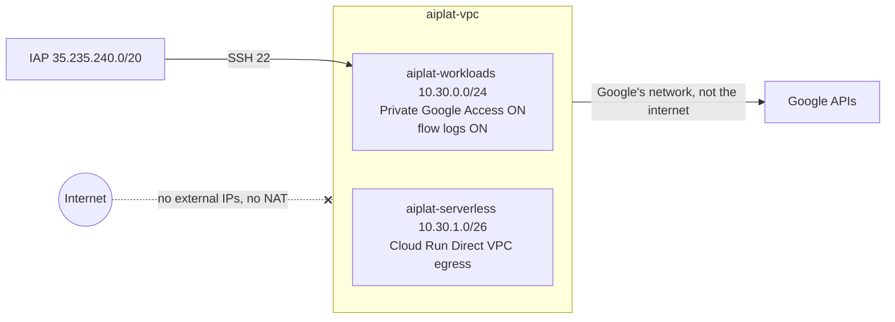

# Week 1: A private network for AI

**Goal:** the network every later week plugs into. No external IPs, no Cloud NAT, so nothing can reach the internet. Workloads still reach Google APIs (Gemini, Secret Manager, Artifact Registry) over Google's own network with **Private Google Access**.



## Deploy (5 minutes)

```bash
make week1
```

The first run also turns on the APIs the course uses. That can take a minute or two.

## What you built, and why

| Resource | Why an AI platform needs it |
| --- | --- |
| Custom-mode VPC, two subnets | You choose every range. Auto mode creates subnets in every region |
| Private Google Access | Machines with no external IP can still call Google APIs |
| Firewall: SSH only from IAP | The test VM has no public SSH; Identity-Aware Proxy checks your identity first |
| Flow logs | Evidence of where traffic goes |
| `aiplat-serverless` subnet | Cloud Run services attach here (Direct VPC egress) in weeks 4 and 5 |

## Check your work

```bash
gcloud compute networks subnets describe aiplat-workloads --region northamerica-northeast1 --format="value(privateIpGoogleAccess)"
gcloud compute routers list    # should be empty: no Cloud Router, no NAT
```

- [ ] Private Google Access is `True`
- [ ] No Cloud NAT exists

## Production differences (say these in interviews)

- **Shared VPC** in a host project, with service projects for each workload
- **VPC Service Controls** perimeter around AI projects, and `restricted.googleapis.com` (199.36.153.4/30) instead of `private`. Needs an Organization (week 3)
- **Private DNS for Google APIs**: a private zone that points `*.googleapis.com` at `private.googleapis.com` or `restricted.googleapis.com`, so API traffic uses addresses that only exist inside Google Cloud. This lab skips it on purpose: the gateway calls Model Armor on a regional `rep.googleapis.com` endpoint, which Private Google Access doesn't support, and a wildcard zone would break that
- **Private Service Connect** endpoints for Google APIs (about USD 0.01 an hour each) when you need your own internal IP for APIs, or for the regional `rep` endpoints
- Built with the [Cloud Foundation Fabric](https://github.com/GoogleCloudPlatform/cloud-foundation-fabric) or the [Terraform example foundation](https://github.com/terraform-google-modules/terraform-example-foundation), not hand-written

## Cost

VPCs, subnets and firewall rules are free. Flow logs are charged by volume sent to Cloud Logging (small here).

## Resume bullet

> Designed an internet-free Google Cloud network for AI workloads in Terraform: Private Google Access for Google APIs, IAP-only administrative access, and flow logs as evidence.

## Go deeper

- [Private Google Access](https://docs.cloud.google.com/vpc/docs/private-google-access)
- [Configure Private Google Access (DNS for private.googleapis.com)](https://docs.cloud.google.com/vpc/docs/configure-private-google-access)
- [Use IAP for TCP forwarding](https://docs.cloud.google.com/iap/docs/using-tcp-forwarding)
