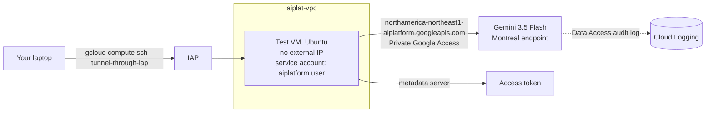

# Week 2: A private path to Gemini, and proof that it's private

**Goal:** call an approved Gemini model on its **Montreal** endpoint from a VM that has no internet, with no keys anywhere, and prove each part of that claim.



## Choosing a model and endpoint for a Canadian bank

| Choice | This course | Why |
| --- | --- | --- |
| Model | `gemini-3.5-flash` | Available in northamerica-northeast1 for both model availability and ML processing (October 2026). Gemini 2.5 models were retired on October 20, 2026 |
| Endpoint | `northamerica-northeast1-aiplatform.googleapis.com` | The regional endpoint keeps processing in Montreal. The `global` endpoint can process anywhere, so a Canada-only workload should never use it |
| Auth | Service account token from the metadata server | No API keys exist |

Vertex AI is now called **Gemini Enterprise Agent Platform** (April 2026). The API host is still `aiplatform.googleapis.com`. Model availability changes often; check the [locations page](https://docs.cloud.google.com/gemini-enterprise-agent-platform/resources/locations) before you change the model.

## Deploy (3 minutes)

```bash
make week2
```

| Resource | Why |
| --- | --- |
| Service account `aiplat-jumpbox` with `roles/aiplatform.user` | May call models, nothing else |
| VM `aiplat-jumpbox` (e2-small, Ubuntu, no external IP, Shielded VM, OS Login) | Your eyes inside the VPC |
| Instance schedule | Stops the VM at 19:00 Toronto time every day |
| Data Access audit logs for `aiplatform.googleapis.com` | They're **off by default**. Turned on, every model call records who called what |

## Prove it

```bash
make week2-test
```

Expected:

```
== 1. No internet ==
PASS no route to the internet
== 2. But Google APIs are reachable (Private Google Access) ==
northamerica-northeast1-aiplatform.googleapis.com -> 142.250.x.x (a Google address, reached over Google's network, not the internet)
== 3. Token from the service account ==
PASS got a token
== 4. Call Gemini on the regional endpoint ==
HTTP 200
Answer: Hello from a private network!
```

Then find the call in **Logging > Logs Explorer**: `protoPayload.serviceName="aiplatform.googleapis.com"`. You'll see the caller (the VM's service account) and the method.

## An honest note: what "private" means here

Unlike Azure, Gemini doesn't have a "public access off" switch per project. Your laptop can call the same API with your own credentials. What makes the platform private is:

1. Workloads have **no internet path**; they reach Google APIs only over Google's network
2. Only specific service accounts hold `aiplatform.user`
3. With an **Organization**, a **VPC Service Controls** perimeter blocks API calls from outside your network, even with valid credentials. That's the control banks use, and week 3 explains it

## Break it on purpose

1. Remove `roles/aiplatform.user` from the VM's service account and run the test. You get 403 `PERMISSION_DENIED`. Put it back with `make week2`
2. In `prove-private.sh`, change the host to `aiplatform.googleapis.com` and the location to `global`. It may work, and that's the problem: processing location is no longer guaranteed

## Cost

e2-small in Montreal is roughly 0.02 USD an hour while running (check the Compute Engine pricing page for your region); it stops every evening. Gemini tokens for this lab cost cents.

## Resume bullet

> Built private access to Gemini on Google Cloud: internet-free VMs using Private Google Access, regional (Montreal) model endpoints only, keyless service-account authentication, and Data Access audit logging, verified with automated tests.

## Go deeper

- [Gemini Enterprise Agent Platform locations](https://docs.cloud.google.com/gemini-enterprise-agent-platform/resources/locations)
- [Introducing Gemini Enterprise Agent Platform](https://cloud.google.com/blog/products/ai-machine-learning/introducing-gemini-enterprise-agent-platform)
- [Data Access audit logs](https://docs.cloud.google.com/logging/docs/audit/configure-data-access)
