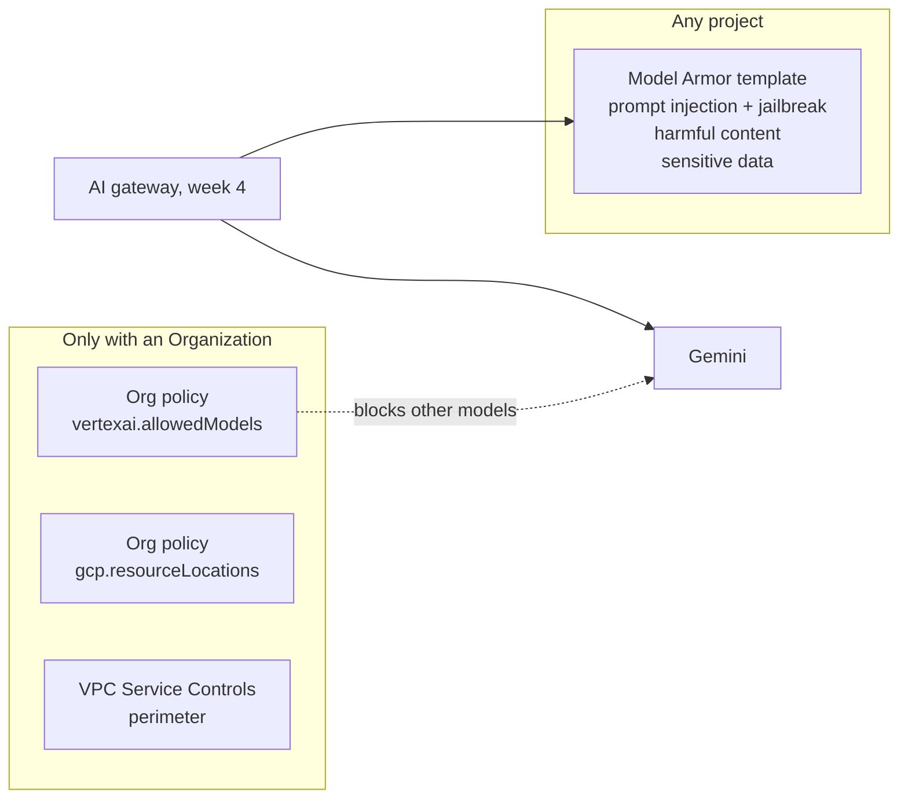

# Week 3: Guardrails as code

**Goal:** put safety and policy controls in code. Every prompt and answer will pass through **Model Armor**, and (if you have an Organization) only the approved model can be called, only in Canada.



## Deploy (2 minutes)

```bash
make week3              # Model Armor template
make week3 ORG=true     # also the org policies, if your project is in an Organization
```

## Model Armor

The template `aiplat-bank-assistant` turns on:

| Filter | Catches |
| --- | --- |
| Prompt injection and jailbreak | "Ignore your instructions", role-play tricks |
| Responsible AI | Hate speech, harassment, dangerous and sexually explicit content |
| Sensitive data (basic) | Credit card numbers and other common sensitive data types |

It lives in **Toronto** (`northamerica-northeast2`). Model Armor wasn't offered in Montreal in October 2026, and Toronto doesn't have the malicious-URL filter, so that filter is left out. Check [feature availability by region](https://docs.cloud.google.com/model-armor/feature-availability-by-region) before you change it.

Model Armor's first 2 million tokens a month are free, then USD 0.10 per million (October 2026).

## Prove it

```bash
make week3-test
```

Expected:

```
PASS  normal banking question passes
PASS  prompt injection is caught
PASS  card number is caught
3 passed, 0 failed
```

The test calls Model Armor's `sanitizeUserPrompt` directly from your laptop. In week 4 the gateway calls it on every request, before and after the model.

## Org policies and VPC Service Controls (Organization only)

Personal Gmail projects have no **Organization**, and org policies and VPC Service Controls only exist inside one. If your project is in an Organization (a company sandbox, or a free Cloud Identity setup with your own domain), `make week3 ORG=true` adds:

| Policy | Value | Effect |
| --- | --- | --- |
| `vertexai.allowedModels` | `is:publishers/google/models/gemini-3.5-flash:predict` | Any other model call fails, for everyone in the project |
| `gcp.resourceLocations` | Montreal and Toronto location groups | Resources can't be created outside Canada |

Then try a different model from the VM (week 2's script with `MODEL=gemini-2.5-pro`). It's refused with a constraint violation.

**VPC Service Controls** is the strongest control for AI data on Google Cloud: a perimeter around the project so even valid credentials can't call Gemini or read data from outside your network. It's not in this lab's Terraform because it needs an Organization-level access policy, but you should be able to explain it:

- Perimeter around the AI project, with `aiplatform.googleapis.com`, `modelarmor.googleapis.com`, `secretmanager.googleapis.com` and storage as restricted services
- Workloads use `restricted.googleapis.com` (199.36.153.4/30)
- Ingress and egress rules for the CI/CD identity and admin access
- Always start in **dry-run** mode and read the violation logs before enforcing

## The rollout process interviewers ask about

1. Model Armor in **inspect-only** first: log what it would block, tune, then block
2. Org policies in **dry-run** (`dry_run_spec`) at the folder level, read the violations, then enforce
3. Every exception has an owner, a reason and an expiry date

## Check your work

- [ ] `make week3-test` shows 3 passed
- [ ] You can explain why org policies and VPC Service Controls need an Organization
- [ ] You can name the four layers that keep Gemini traffic in Canada in this course (regional endpoint, resource locations, Model Armor location, inventory check)

## Resume bullet

> Codified AI guardrails on Google Cloud: Model Armor screening for prompt injection, harmful content and sensitive data, plus org policies restricting approved models and resource locations, rolled out with dry-run first.

## Go deeper

- [Model Armor overview](https://docs.cloud.google.com/model-armor/overview)
- [Control access to models (vertexai.allowedModels)](https://docs.cloud.google.com/gemini-enterprise-agent-platform/models/control-model-access)
- [VPC Service Controls overview](https://docs.cloud.google.com/vpc-service-controls/docs/overview)
