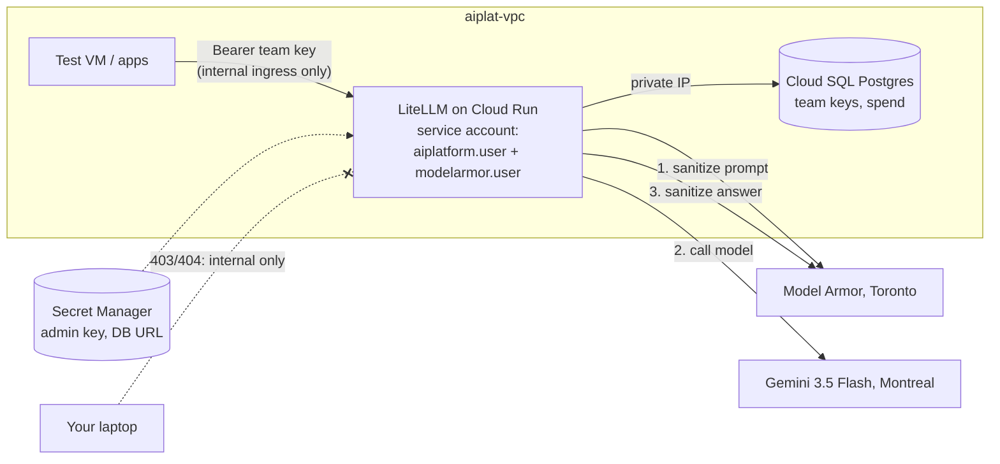

# Week 4: The AI gateway

**Goal:** one front door between every app and every model. Apps get a team key with a budget. Only the gateway's service account can call Gemini, and every prompt and answer goes through Model Armor. Nothing outside the VPC can reach it.



## Apigee or LiteLLM?

| | Apigee AI policies | LiteLLM on Cloud Run (this course) |
| --- | --- | --- |
| Token quotas per app | `LLMTokenQuota`, `PromptTokenLimit` | Team keys with `tpm_limit`, `rpm_limit`, budgets |
| Model Armor | `SanitizeUserPrompt`, `SanitizeModelResponse` | Built-in `model_armor` guardrail |
| Semantic cache | `SemanticCacheLookup` / `Populate` | Available, not used here |
| Cost | AI policies are "extensible" policies, so they need an **Intermediate** environment, about USD 1,460 a month per region (October 2026). A 60-day evaluation org is free, but Google doesn't say whether it supports the AI policies | Cloud Run scales to zero; Cloud SQL micro |
| Who runs it | Google | You |

In a bank already running Apigee, the Apigee AI policies are the natural choice. Being able to explain this table is worth more in an interview than the Terraform.

## Deploy (about 15 minutes)

```bash
make week4
```

It runs three steps: creates the registry, Cloud SQL (private IP only) and secrets; builds the gateway image with **Cloud Build** from [gateway/](../../infra/week04-ai-gateway/gateway) (no Docker needed on your laptop); then deploys the Cloud Run service. Cloud SQL creation takes most of the time.

## What the gateway does on every request

| Step | Where | What the caller sees when it trips |
| --- | --- | --- |
| Came from inside the VPC? | Cloud Run ingress `INTERNAL_ONLY` | 404 or 403 |
| Valid team key? | LiteLLM | 401 |
| Model allowed for this key? | LiteLLM | 403 |
| Over requests or tokens per minute? | LiteLLM | 429 |
| Prompt passes Model Armor? | `model_armor` guardrail, pre-call | Blocked with an error |
| Call Gemini as the gateway's service account, Montreal endpoint | `vertex_ai/gemini-3.5-flash` | |
| Answer passes Model Armor? | `model_armor` guardrail, post-call | Blocked with an error |
| Record tokens and spend per key | Cloud SQL | Used in week 7 |

## Test it

```bash
make week4-test
```

Expected:

```
From your laptop first (should be refused by Cloud Run's internal-only ingress):
  HTTP 404  (404 or 403 expected)

PASS  gateway is healthy
PASS  a made-up key is refused (401)
PASS  team key works (200)
      answer: An AI gateway sits between applications and AI models...
PASS  team key can't use other models (403)
PASS  the key's 2-per-minute limit kicks in (429)
5 passed, 0 failed
```

## Design choices to defend in an interview

- **Network egress.** The gateway sends only private ranges (Cloud SQL) through the VPC. Its Google API calls go over Google's network directly. That's because Model Armor's regional endpoints (`*.rep.googleapis.com`) aren't supported over Private Google Access; production would add a Private Service Connect endpoint for them and route everything through the VPC
- **Cloud Run IAM invoker check is off.** Internal ingress plus LiteLLM keys is the control here. Production adds Cloud Run IAM so only known service accounts can call the gateway
- **Cloud SQL `db-f1-micro`.** Shared core, no SLA. Fine for a lab; production uses a dedicated tier with high availability
- **Scale to zero.** Cold starts take a few seconds. Production keeps one warm instance

## Cost

| Item | About |
| --- | --- |
| Cloud SQL `db-f1-micro` | Roughly USD 0.01 an hour plus storage (Iowa list price; check Montreal on the pricing page). `make pause` stops it |
| Cloud Run | Scales to zero; pennies for the lab |
| Cloud Build, Artifact Registry, Secret Manager | Within free tiers or cents |
| Model Armor | Free up to 2 million tokens a month |

## Resume bullet

> Built a multi-tenant AI gateway on Google Cloud: LiteLLM on internal-only Cloud Run with per-team keys and token limits, Model Armor screening on every prompt and response, keyless access to regional Gemini endpoints, and a private-IP Cloud SQL backend, all in Terraform.

## Go deeper

- [Apigee AI token policies tutorial](https://docs.cloud.google.com/apigee/docs/api-platform/tutorials/using-ai-token-policies)
- [Compare Apigee evaluation and paid organizations](https://docs.cloud.google.com/apigee/docs/api-platform/get-started/compare-paid-eval)
- [LiteLLM: Vertex AI provider](https://docs.litellm.ai/docs/providers/vertex) and [Model Armor guardrail](https://docs.litellm.ai/docs/proxy/guardrails/model_armor)
- [Cloud Run ingress](https://docs.cloud.google.com/run/docs/securing/ingress)
