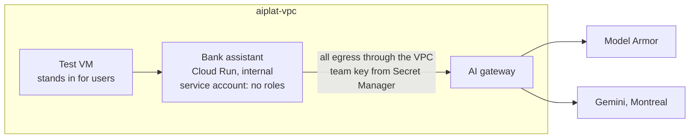

# Week 5: Run the bank assistant privately

**Goal:** host a real AI workload on your platform. The Maple Leaf Bank assistant (a RAG chatbot plus an agent that can move money) runs on Cloud Run with internal-only ingress. It reaches a model only through the gateway, and its service account has **no Google Cloud roles at all**.



## Deploy (10 minutes)

```bash
make week5
```

It runs four steps:

1. Builds the app image from [app/Dockerfile](../../app/Dockerfile) with Cloud Build
2. Creates the app's service account and an empty secret for its gateway key
3. [week5-key.sh](../../scripts/week5-key.sh) creates a team key for the app on the gateway (60 requests and 20,000 tokens per minute), from the VM, and stores it in Secret Manager
4. Deploys the Cloud Run service

The app uses Direct VPC egress for **all** traffic. That's what makes its calls to the gateway count as "internal", so they pass the gateway's internal-only ingress.

## Test it

```bash
make week5-test
```

Expected:

```
From your laptop (should be refused, internal ingress only): HTTP 404
== Health ==
{"status":"ok","chunks":8,"mode":"llm"}
== Ask: app -> gateway -> Model Armor -> Gemini ==
Answer: An international wire transfer costs $30 per transfer. (wording varies)
Mode: llm | latency ms: 1500
== Agent: money moves only with confirmation ==
Answer: (wording varies)
Tool calls: [{'name': 'transfer_funds', 'arguments': {...}, 'result': {'status': 'needs_confirmation'}}]
```

## Count the credentials

| Hop | How it authenticates | Secret stored? |
| --- | --- | --- |
| Cloud Run pulls images | Google-managed | No |
| App calls the gateway | Team key | Yes, one, in Secret Manager |
| Gateway calls Gemini and Model Armor | Gateway service account | No |

One secret, and it's a gateway key you can revoke in seconds without touching Gemini.

## Break it on purpose

1. Disable the app's secret version (`gcloud secrets versions disable latest --secret aiplat-bank-app-gateway-key`), then deploy a new revision. It can't start: no key. Re-enable it
2. Give the app's service account `roles/aiplatform.user` and ask yourself: what would an attacker who got code execution in the app now be able to do? Remove it again. That's why the app has no roles

## Check your work

- [ ] `make week5-test` answers with `"mode": "llm"`
- [ ] Your laptop can't reach the app
- [ ] `gcloud projects get-iam-policy` shows no roles for `aiplat-bank-app@...`

## Cost

Cloud Run scales to zero. The app costs pennies for this lab.

## Resume bullet

> Deployed a containerized RAG and agent application on internal-only Cloud Run with Direct VPC egress, a role-less service account, and model access only through a central AI gateway using a revocable per-team key.

## Go deeper

- [Direct VPC egress for Cloud Run](https://docs.cloud.google.com/run/docs/configuring/vpc-direct-vpc)
- [Private networking and Cloud Run](https://docs.cloud.google.com/run/docs/securing/private-networking)
