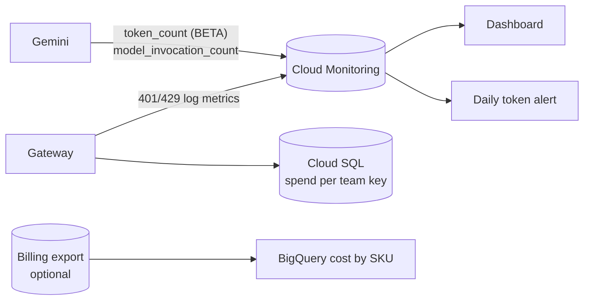

# Week 7: Observability and FinOps

**Goal:** answer "which team is spending what?" and "is the platform healthy?" with numbers: Gemini's own token metrics for the whole project, and the gateway's spend per team key.



## Deploy (1 minute)

```bash
make week7
```

Generate some traffic first: run `make week5-test` a few times, then open **Monitoring > Dashboards > AI platform: Gemini usage and gateway health**.

The token metric `aiplatform.googleapis.com/publisher/online_serving/token_count` is **BETA** (October 2026). If a chart is empty, open Metrics Explorer, search for "token", and check the metric and labels your project actually reports. Fix the dashboard to match. Never trust a dashboard you haven't checked against the raw metric.

## Spend per team key

The gateway records tokens and spend for every key in Cloud SQL:

```bash
GW=$(terraform -chdir=infra/week04-ai-gateway output -raw gateway_url)
MASTER=$(gcloud secrets versions access latest --secret aiplat-gateway-master-key)
./scripts/on-vm.sh "curl -s '$GW/key/list?return_full_object=true' -H 'Authorization: Bearer $MASTER'" | python3 -m json.tool | head -40
```

Dollar figures come from LiteLLM's built-in price table, so treat them as estimates. Your Cloud Billing report is the truth.

## FinOps decisions you should be able to make

1. **Project cost vs team cost.** Billing shows cost by project and SKU. The gateway shows who caused it. Many companies use one project per team, or labels, plus gateway data, and reconcile monthly
2. **Billing export to BigQuery.** Turn it on for the billing account (console: Billing > Billing export) to query cost by SKU and label. It's the foundation of every serious FinOps report on Google Cloud
3. **Which model?** Compare `gemini-3.5-flash` with a cheaper "lite" model on the release gate (week 8) and on cost per 1,000 questions, but check that the model is available in Montreal first. Cheaper only wins if the gate still passes
4. **Provisioned Throughput** (bought in GSUs) only makes sense at steady, high volume. Not here
5. **Idle cost.** `make pause` stops Cloud SQL and the VM. Cloud Run already scales to zero

## Check your work

- [ ] The dashboard shows input and output tokens (after checking the metric names)
- [ ] You found the spend for the `retail-banking-app` key on the gateway
- [ ] You lowered `daily_output_token_allowance` to 100, re-applied, generated traffic, and got the alert email

## Cost

Custom dashboards are free. Cloud Monitoring charges for metric ingestion above free allowances; Google's own platform metrics like these are free.

## Resume bullet

> Built AI FinOps on Google Cloud: Gemini token and invocation dashboards from platform metrics, daily token alerts, and per-team spend reconciliation from the AI gateway.

## Go deeper

- [Google Cloud metrics: aiplatform](https://docs.cloud.google.com/monitoring/api/metrics_gcp_a_b)
- [Export Cloud Billing data to BigQuery](https://docs.cloud.google.com/billing/docs/how-to/export-data-bigquery)
- [LiteLLM spend tracking](https://docs.litellm.ai/docs/proxy/cost_tracking)
