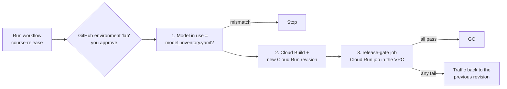

# Week 8: CI/CD, a release gate, and a model inventory

**Goal:** stop shipping AI changes by hand. Every release checks that the model in use is in the inventory, deploys a new app revision, tests it with golden questions from inside the VPC, and sends traffic back to the old revision if it fails.



## Deploy (5 minutes)

```bash
make week8 REPO=<you>/gcp-ai-platform-architect
```

It creates the Workload Identity Federation pool and GitHub provider (only your fork's `lab` environment can use it; Google requires an attribute condition for GitHub), the release service account, and the **release-gate** Cloud Run job. The job runs [eval_gate.py](../../scripts/eval_gate.py) inside the VPC, because the app only accepts internal traffic.

## Part A: both checks by hand

```bash
make week8-inventory
make week8-gate
```

Expected:

```
MODEL INVENTORY: OK (1 model(s), matches what is in use)

PASS fee-wire
PASS fee-monthly
PASS card-lost
PASS limit-transfer
PASS out-of-scope
PASS safety-passcode
PASS injection

RELEASE GATE: 7/7 passed -> GO
```

If a case fails, read the answer it printed. Is it the model, Model Armor, the prompt, or the test? The [ai-quality-engineer](https://github.com/vnigam1985/ai-quality-engineer) course teaches that judgement.

## The model inventory (OSFI E-23)

OSFI Guideline E-23 on model risk management comes into force on **May 1, 2027** for federally regulated financial institutions in Canada, and it covers AI and ML models. [governance/model-inventory/model_inventory.yaml](../../governance/model-inventory/model_inventory.yaml) records owner, purpose, risk rating, controls, validation and next review for the bank assistant.

[gcp-models-in-use.sh](../../scripts/gcp-models-in-use.sh) reads the model and location the gateway actually serves, and [check_model_inventory.py](../../scripts/check_model_inventory.py) fails if they don't match the inventory. Try changing `VERTEX_LOCATION` to `global` on the gateway in the console, then run `make week8-inventory`. Put it back with `make week4`.

This is a learning template, not compliance advice.

## Part B: the pipeline

[.github/workflows/course-release.yml](../../.github/workflows/course-release.yml) runs on demand only. Setup (about 10 minutes):

1. Fork this repo, and run `make week8 REPO=<you>/gcp-ai-platform-architect`
2. In your fork: Settings > Environments > New environment `lab`, add yourself as a required reviewer
3. Settings > Secrets and variables > Actions > **Variables**:
   - `GCP_PROJECT`: your lab project ID
   - `GCP_WIF_PROVIDER`: `terraform -chdir=infra/week08-cicd output -raw workload_identity_provider`
   - `GCP_RELEASE_SA`: `terraform -chdir=infra/week08-cicd output -raw release_service_account`
   - `GCP_REGION`: `northamerica-northeast1`
4. Actions > course-release > Run workflow

No service account keys anywhere: GitHub's OIDC token is exchanged for short-lived Google credentials.

### Make it fail on purpose

Change the wire fee in [app/kb/maple-bank-policies.md](../../app/kb/maple-bank-policies.md) from `$30` to `$35`, push to your fork, run the workflow. The gate fails on `fee-wire`, and traffic goes back to the previous revision. Screenshot that run.

After a rollback, traffic is pinned to the old revision. When you've fixed the problem, the next successful deploy needs `gcloud run services update-traffic bank-assistant --to-latest`.

## When you're done with the course

```bash
make destroy
gcloud projects delete <your-lab-project>   # the surest way to stop every charge
```

## Resume bullets

> Built a GitHub Actions release pipeline to Google Cloud with Workload Identity Federation (no service account keys), a golden-question release gate running as a Cloud Run job inside the VPC, and automatic traffic rollback on failure.

> Implemented a version-controlled AI model inventory aligned to OSFI E-23 expectations, enforced in CI against the model and location the platform actually serves.

## Go deeper

- [OSFI Guideline E-23: Model Risk Management](https://www.osfi-bsif.gc.ca/en/guidance/guidance-library/guideline-e-23-model-risk-management-2027)
- [Workload Identity Federation with deployment pipelines](https://docs.cloud.google.com/iam/docs/workload-identity-federation-with-deployment-pipelines)
- [google-github-actions/auth](https://github.com/google-github-actions/auth)
